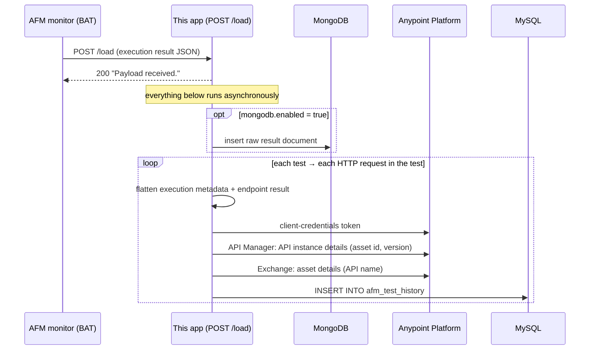

# API Functional Monitoring Test History

A Mule 4 application that keeps a long-term, queryable history of **Anypoint API Functional Monitoring (AFM)** results.

AFM monitors run BAT test suites on a schedule. Their results are only visible in AFM for a limited time and can't be easily queried across monitors. This app acts as a **custom reporter** for those monitors. Every time a monitor runs, AFM posts the full result to this app, which:

- writes **one row per tested endpoint** to a **MySQL** table, enriched with the API's name and version from Anypoint Platform. You can use the table for reporting, dashboards, and SLA tracking.
- *optionally* archives the **raw result document** in **MongoDB**.

### MySQL vs. MongoDB

| | MySQL (required) | MongoDB (optional) |
|---|---|---|
| What's stored | One flattened row per tested endpoint per run | The complete AFM result exactly as received, one document per run |
| Detail | Monitor and execution IDs, endpoint name, pass/fail, start time, duration, API name and version | Everything AFM sends: every assertion with expected and actual values, request and response details, headers, errors |
| Use it for | Reporting, dashboards, SLA trends (e.g. "pass rate of API X over the last 30 days") | Investigating *why* a test failed; a complete archive in case you want to report on fields that aren't in the MySQL table |
| Written when | The API lookup succeeds (needs the `x-api-instance-id` header) | Every run, whether or not the API lookup succeeds |

MongoDB is **disabled by default**. Enable it with `mongodb.enabled=true` if you want the raw archive. Neither store reads from the other. If a MongoDB write fails, the app logs the error and still writes the MySQL rows.

> **Note:** The raw MongoDB document includes the request headers captured by AFM. If your monitors send API credentials as headers, such as `client_id`/`client_secret`, those values are stored in MongoDB as-is. Restrict access to the collection accordingly.

## How it works



1. A BAT `Custom` reporter in the monitor's `bat.yaml` posts the execution result to `POST /load`.
2. The app replies immediately. The rest of the processing runs in an `async` scope, so a slow or failing database never makes the monitor fail.
3. If MongoDB is enabled, the raw result is stored as-is in the configured collection. A failure here is logged and doesn't stop the MySQL step.
4. The app walks the result (suite → `it should` tests → HTTP requests). For each HTTP request it builds a flat record that combines:
   - the monitor execution metadata: name, execution, schedule, target, and test IDs
   - the endpoint result: request name, pass/fail, start time, and duration
5. It reads the **API instance ID** from the request's `x-api-instance-id` header. It uses that ID to look up the API's version in API Manager and its name in Exchange.
6. The enriched record is inserted into the MySQL table `afm_test_history`.

> **Every request in your monitor must send an `x-api-instance-id` header** with the API Manager instance ID of the API being tested. Without it, the API lookup fails and no MySQL row is written for that request. If MongoDB is enabled, the raw document is still saved.

Example payloads are in [`src/main/resources/examples/`](src/main/resources/examples).

## Prerequisites

- **Anypoint Platform** account with CloudHub 1.0, API Manager, Exchange, and API Functional Monitoring
- **MySQL 8** reachable from CloudHub
- **MongoDB** reachable from CloudHub (*optional*, only if you enable the raw archive)
- **JDK 17** and **Maven 3.8+** to build. The build fails on newer JDKs, because the MongoDB connector only supports Java up to 17.
- **Anypoint Studio** or **Anypoint Code Builder** (optional, for local runs)
- **anypoint-cli-v4** (optional, for CLI deployment)
- **BAT CLI** (optional, for running and uploading monitors)

## Setup

### 1. Create the MySQL table

Run [`src/test/resources/ddl.sql`](src/test/resources/ddl.sql) against your MySQL database. It creates `afm_test_history`.

If you enable MongoDB, the collection is created automatically on first insert.

### 2. Create an Anypoint connected app

The app calls the Anypoint Platform APIs with a **client credentials** connected app. In **Access Management → Connected Apps**, create an app that acts on its own behalf. Grant it these scopes for the environment that holds your APIs:

- **API Manager → View APIs Configuration**
- **Exchange → Exchange Viewer**

Note its client ID and secret.

### 3. Network access

CloudHub workers must be able to reach your MySQL host, and your MongoDB host if it's enabled. If your databases only accept allow-listed IPs, enable **static IPs** for the app in Runtime Manager and allow-list them.

## Configuration

Non-secret defaults are in [`src/main/resources/config.yaml`](src/main/resources/config.yaml). Placeholder values (`YOUR_...`) must be replaced. You can edit the file or override any key with a CloudHub application property; properties take precedence over the file.

| Property | Description | Default |
|---|---|---|
| `http.port` | HTTP listener port. CloudHub 1.0 routes public traffic to 8081. | `8081` |
| `mongodb.enabled` | Archive raw results in MongoDB (`true`/`false`) | `false` |
| `mongodb.host` / `mongodb.port` | MongoDB server (only used when enabled) | `YOUR_MONGODB_HOST` / `27017` |
| `mongodb.database` / `mongodb.collection` | Where raw results are stored | `demo` / `afm-test-history-alc` |
| `mysqldb.host` / `mysqldb.port` | MySQL server | `YOUR_MYSQL_HOST` / `3306` |
| `mysqldb.database` | Database that holds `afm_test_history` | `demodb` |
| `anypoint.platform.host` | Control plane host. Use `eu1.anypoint.mulesoft.com` for the EU control plane. | `anypoint.mulesoft.com` |
| `anypoint.platform.org_id` | Business group ID that owns the monitored APIs | `YOUR_ORG_ID` |
| `anypoint.platform.env_id` | Environment ID of the monitored API instances | `YOUR_ENV_ID` |

### Secure properties

These have **no value in the repo** and must be supplied at deploy time:

| Property | Description |
|---|---|
| `mongodb.user` / `mongodb.password` | MongoDB credentials (only when MongoDB is enabled) |
| `mysqldb.user` / `mysqldb.password` | MySQL credentials |
| `anypoint.platform.auth.client_id` / `anypoint.platform.auth.client_secret` | Connected app from setup step 2 |

They are declared under `secureProperties` in [`mule-artifact.json`](mule-artifact.json). As a result, CloudHub masks their values in Runtime Manager after they are saved. Never commit real values to `config.yaml`.

## Build

```bash
export JAVA_HOME=/path/to/jdk-17
mvn clean package
```

This produces `target/api-functional-monitoring-test-history-1.0.0-mule-application.jar`.

## Run locally

Import the project into Anypoint Studio or Anypoint Code Builder. In the run configuration, set the Mule runtime to 4.9.x on Java 17. Pass the secure properties (and any overridden placeholders) as runtime arguments:

```
-M-Dmysqldb.user=... -M-Dmysqldb.password=...
-M-Danypoint.platform.auth.client_id=... -M-Danypoint.platform.auth.client_secret=...
```

Add `-M-Dmongodb.enabled=true -M-Dmongodb.host=... -M-Dmongodb.user=... -M-Dmongodb.password=...` to enable the MongoDB archive.

Then send a sample result:

```bash
curl -X POST http://localhost:8081/load \
  -H 'Content-Type: application/json' \
  -d @src/main/resources/examples/afm-test-history-execution-single-endpoint-example.json
```

The sample payload uses placeholder API instance IDs. To get a MySQL row, change `X-Api-Instance-Id` in the payload to a real API instance in your environment.

## Deploy to CloudHub 1.0

The app targets **Mule 4.9 LTS on Java 17**.

### Option A: Runtime Manager UI

1. In **Runtime Manager**, select the target environment and click **Deploy application**.
2. Enter an application name. It must be globally unique, because it becomes `<app-name>.<region>.cloudhub.io`.
3. For **Deployment Target**, choose **CloudHub**, then upload the jar from `target/`.
4. Under **Runtime**:
   - Runtime version: **4.9.x**, release channel **LTS**
   - Java version: **17**
   - Worker size: **0.1 vCore** is enough
   - Region: the one closest to your databases
5. Under **Properties**, add the secure properties and the placeholder overrides, one `name=value` per line:
   ```
   mysqldb.host=...
   mysqldb.user=...
   mysqldb.password=...
   anypoint.platform.org_id=...
   anypoint.platform.env_id=...
   anypoint.platform.auth.client_id=...
   anypoint.platform.auth.client_secret=...
   ```
   To enable the MongoDB archive, also add:
   ```
   mongodb.enabled=true
   mongodb.host=...
   mongodb.user=...
   mongodb.password=...
   ```
6. Click **Deploy Application**.

### Option B: anypoint-cli-v4

Authenticate the CLI first, for example with `ANYPOINT_CLIENT_ID`, `ANYPOINT_CLIENT_SECRET`, `ANYPOINT_ORG`, and `ANYPOINT_ENV`. Read the secret values from environment variables so they don't end up in your shell history:

```bash
anypoint-cli-v4 runtime-mgr cloudhub-application deploy \
  YOUR_APP_NAME target/api-functional-monitoring-test-history-1.0.0-mule-application.jar \
  --runtime 4.9.0 --releaseChannel LTS --javaVersion 17 \
  --workers 1 --workerSize 0.1 --region us-east-2 \
  --property "mysqldb.host:$MYSQL_HOST" \
  --property "mysqldb.user:$MYSQL_USER" \
  --property "mysqldb.password:$MYSQL_PASSWORD" \
  --property "anypoint.platform.org_id:$ANYPOINT_ORG_ID" \
  --property "anypoint.platform.env_id:$ANYPOINT_ENV_ID" \
  --property "anypoint.platform.auth.client_id:$AP_CLIENT_ID" \
  --property "anypoint.platform.auth.client_secret:$AP_CLIENT_SECRET"
```

To enable the MongoDB archive, add:

```bash
  --property "mongodb.enabled:true" \
  --property "mongodb.host:$MONGODB_HOST" \
  --property "mongodb.user:$MONGODB_USER" \
  --property "mongodb.password:$MONGODB_PASSWORD"
```

To ship a new build to an existing app, use `anypoint-cli-v4 runtime-mgr cloudhub-application modify YOUR_APP_NAME <jar>`.

Once it's running, the reporter endpoint is:

```
http://YOUR_APP_NAME.<region>.cloudhub.io/load
```

## Point your monitors at the app

The sample monitor suite is in [`src/test/resources/api-health-check-monitor/`](src/test/resources/api-health-check-monitor). A variant is in `src/test/resources/scripts/api-health-check-monitor/`.

1. **`exchange.json`**: set `groupId` to your org ID.
2. **`main.dwl`**: replace the `YOUR_API_HOST_*` URLs and `YOUR_API_INSTANCE_ID_*` values with your APIs. Keep the `x-api-instance-id` header on every request.
3. **`bat.yaml`**: set the `Custom` reporter `URL` to your deployed `/load` endpoint:
   ```yaml
   reporters:
     - type: Custom
       options:
         URL: "http://YOUR_APP_NAME.<region>.cloudhub.io/load"
         HEADERS: "'Content-Type':'application/json'"
   ```
4. **Client credentials for the monitored APIs**: `main.dwl` reads them with `secret('clientId-alias')` and `secret('clientSecret-alias')`. They come from **Anypoint Secrets Manager**, so no credentials live in the script.
   - Create symmetric-key shared secrets, with Base64-encoded values, in a secrets group in the same environment that BAT uses.
   - Grant the monitor access:
     ```bash
     bat grant -g=YOUR_SECRET_GROUP -s=clientId-alias:YOUR_CLIENT_ID_SECRET_NAME,clientSecret-alias:YOUR_CLIENT_SECRET_SECRET_NAME
     ```
   - AFM supports Secrets Manager aliases only for monitors that run from a **private location**. For APIs that don't need client credentials, remove those headers.
5. Upload and schedule the monitor in API Functional Monitoring.

After the next scheduled run, you should see one row per request in `afm_test_history`, plus a new document in MongoDB if it's enabled.

## Project layout

| Path | Contents |
|---|---|
| `src/main/mule/global.xml` | Global configs: HTTP listener, MySQL, MongoDB (optional), Anypoint Platform HTTP requester |
| `src/main/mule/import.xml` | `/load` flow and the `GetAPINameAndId` platform-lookup sub-flow |
| `src/main/resources/config.yaml` | Non-secret configuration |
| `src/main/resources/examples/` | Sample AFM result payloads |
| `src/test/resources/ddl.sql` | MySQL schema |
| `src/test/resources/**/api-health-check-monitor/` | Sample BAT monitor suites |
